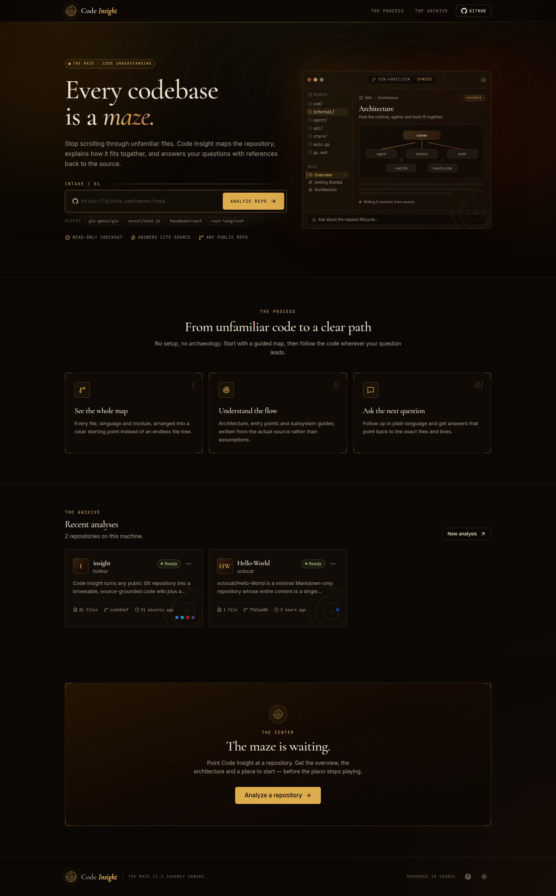
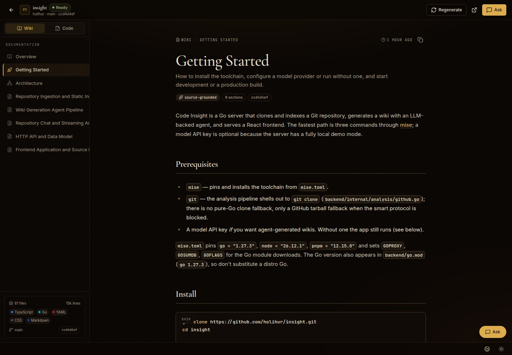
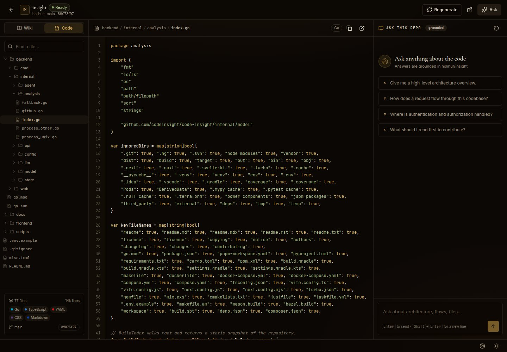
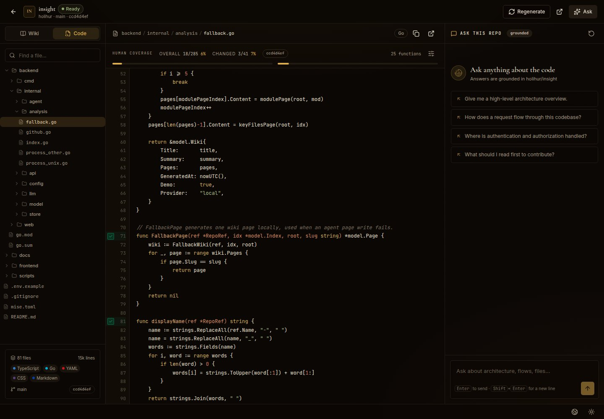
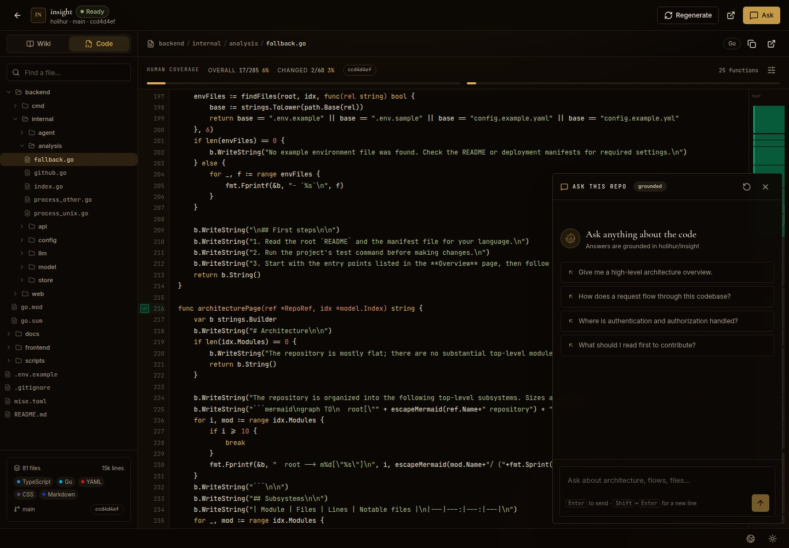

# Code Insight

> 每个代码库都是一座迷宫。Code Insight 带你走到中心。

把任意公开 Git 仓库变成一份**可阅读、可追问、有源码依据**的代码 Wiki。输入仓库地址，剩下的交给分析代理：它会阅读代码、画出结构、解释关键流程，并随时回答你的问题。



## 它做什么

- **输入一个仓库地址**，自动完成拉取、索引和语言 / 模块统计。
- **生成 5–8 个章节的 Wiki**：概览、快速开始、架构、核心子系统、关键文件等。
- **每个结论都来自源码**：代理使用文件树、文件读取和代码搜索工具，而不是凭空猜测。
- **像问同事一样追问**：流式回答，展示它正在读哪个文件、搜什么关键词，并引用真实路径。
- **直接在浏览器里读代码**：左侧文件树支持目录展开，右侧带行号、语法高亮、复制和跳转 GitHub。
- **支持 Mermaid 图**：架构和调用关系可以直接渲染成图。
- **人工覆盖率**：每个方法左侧有勾选标记，确认看过即可打勾，并实时汇总当前 commit 的**总体覆盖率**和**变更覆盖率**。
- **代码 minimap**：代码右侧显示文件缩略图；已人工确认的方法区块变绿，变更为金；点击即可跳转。
- **浮动对话**：Ask 面板默认浮在底部居中，可拖动到任意位置，位置会记住，不占用代码宽度。
- **调用关系索引**：每个 commit 单独建立函数调用图。`Ctrl/⌘ + 点击`函数名跳到定义，`Alt + 点击`查看调用了谁、被谁调用；一个名字有多个实现或调用点时弹出列表。手机上点按函数名即可选择操作。
- **URL 深链接**：视图、Wiki 页面、文件/目录和对话状态都写入 URL，刷新或分享链接不会丢失。
- **忽略规则**：支持按目录、package、通配符排除，界面里的 Filters 或仓库根目录的 `.insightignore` 都可以配置。
- **10 种界面语言**：English、简体中文、Español、हिन्दी、العربية、Português、Русский、日本語、Français、Deutsch。语言与主题切换放在页面底部。



> 上面的仓库页面就是 **Code Insight 分析它自己的仓库** 后生成的。



源码视图使用同一棵目录树，文件内容带语法高亮。



每个方法左侧的勾选标记用于人工确认；顶部只显示当前 commit 的总体/变更覆盖率，不占用代码空间。右侧 minimap 会把已确认的方法区块标绿。



对话面板默认在底部居中，拖动顶部的拖拽条即可移动到任意位置；位置会保存在本地，双击拖拽条复位。

## 快速开始

需要 [mise](https://mise.jdx.dev/) 和 `git`。

```bash
git clone https://github.com/holihur/insight.git
cd insight

mise install          # 安装 Go / Node / pnpm
mise run install      # 安装前后端依赖

cp .env.example .env  # 填入模型 API Key（见下方）
mise run dev          # 后端 :8080，前端 :5173
```

打开 <http://localhost:5173>，粘贴一个公开仓库地址，例如 `gin-gonic/gin`。

### 生产方式运行

```bash
mise run build
mise run start        # http://localhost:8080
```

`mise run build` 会先构建前端，再把前端资源嵌入 Go 二进制。最终只需要一个可执行文件，不依赖 Node 或静态文件目录（`WEB_DIR` 可覆盖）。

## 配置

在项目根目录的 `.env` 中填入模型服务。默认支持 DeepSeek：

```dotenv
DEEPSEEK_API_KEY=sk-...
DEEPSEEK_MODEL=deepseek-flash
```

也支持任意 OpenAI 兼容接口（OpenAI、OpenRouter、Ollama、vLLM 等）：

```dotenv
OPENAI_API_KEY=...
OPENAI_BASE_URL=https://api.openai.com/v1
OPENAI_MODEL=gpt-4o-mini
```

其他常用项：

| 变量 | 默认值 | 说明 |
|---|---|---|
| `PORT` | `8080` | 监听端口 |
| `DATA_DIR` | `./data` | 克隆和生成结果的存放目录 |
| `GITHUB_TOKEN` | 空 | 访问私有仓库时使用 |
| `GIT_CLONE_TIMEOUT` | `180` | Git 克隆超时（秒） |
| `MAX_REPO_FILES` | `8000` | 索引文件数上限 |
| `LLM_MAX_TOKENS` | `8192` | 单次生成上限 |

**没有配置 Key 也能用。** 此时会进入本地模式：用静态分析生成基础 Wiki，用代码搜索回答问题。配置 Key 后点击 **Regenerate** 即可获得完整的代理生成版本。

## 使用方式

1. 在首页粘贴仓库地址，点击 **Analyze repo**。
2. 等待克隆、索引、规划和写作完成（页面会实时显示进度）。
3. 在左侧浏览 Wiki 章节，或切到 **Code** 查看源码。
4. 在右侧 **Ask this repo** 中追问，例如：
   - “Give me a high-level architecture overview.”
   - “How does a request flow through this codebase?”
   - “Where is authentication handled?”
5. 需要重新生成时点击 **Regenerate**；删除分析会同时删除本地克隆。
6. 语言和主题切换在页面底部。
7. 当前视图、Wiki 页面、文件/目录和对话状态都会写入 URL，刷新或把链接发给同事都能直接回到同一位置。
8. 对话面板可以拖动改变位置，位置会记住；双击拖拽条回到默认的底部居中。

例如：

```text
/repo/<id>?view=wiki&page=architecture
/repo/<id>?view=code&path=backend/internal/agent/generate.go
/repo/<id>?view=code&dir=backend/internal
```

## 调用关系

代码视图里，函数名和调用点都可点击：

| 操作 | 桌面端 | 手机端 |
|---|---|---|
| 跳转到定义 | `Ctrl/⌘ + 点击` | 点按 → **Go to definition** |
| 查看调用/被调用 | `Alt + 点击` | 点按 → **Callers & callees** |
| 多个实现/调用点 | 自动弹出候选列表 | 同左 |

- 索引按 commit 持久化在 `data/<repo>/callgraph/<commit>.json`，切换 commit 自动重建，重新分析会失效。
- 目前精确解析 Go（`go/ast`，含同包、跨包、接收者和结构体字段类型）；接口方法等同名多实现会标为 `multiple` 并列出全部候选。
- 其他语言暂时只提供定义入口，调用图后续按语言逐个接入。
- API：`GET /api/repos/{id}/calls?function=<id>`、`GET /api/repos/{id}/callsites?path=<file>`。

## 人工覆盖率

代码视图会在每个方法的起始行显示一个勾选框：

- 勾选表示“这个方法我看过了”，状态按 commit 保存，同一次分析的重新打开不会丢失。
- 顶部汇总当前 commit 的：
  - **总体覆盖率**：已看过的方法 / 仓库内所有方法。
  - **变更覆盖率**：已看过的变更方法 / 本次 commit 变更的方法（与父 commit 对比）。
- 变更方法后面会显示 `changed` 标记。
- 代码右侧的 minimap 会用绿色标出已确认的方法区块；点击对应区块可以跳到方法起始行。
- 首个 commit 没有父 commit，因此所有方法都视为变更；无法获取父 commit 时，变更覆盖率显示为不可用。

### 忽略规则

点击代码覆盖率栏右侧的过滤按钮，或提交一个 `.insightignore` 文件：

```text
# 目录
vendor/
dir:frontend/node_modules

# package（Go module / import path，或目录后缀）
package:internal/generated

# 通配符
**/*_test.go
**/*.pb.go
```

支持目录、package 和通配符。被忽略的文件不会计入总体覆盖率或变更覆盖率。

## 数据与隐私

- 仓库只会以只读方式浅克隆到 `data/<repo-id>/repo`。
- 生成的 Wiki、索引和元数据保存在 `data/<repo-id>/`，不会上传到其他地方。
- `.env`、`data/`、构建产物和依赖目录都已加入 `.gitignore`。
- 删除某个分析时，对应的本地数据会一起删除。

## 开发

```bash
mise run dev      # 前后端一起启动（Vite 代理 /api 到 :8080）
mise run check    # go vet + TypeScript 类型检查
mise run build    # 构建前端并编译 Go 二进制
```

目录结构：

```text
backend/   Go 服务：克隆 / 索引 / 分析代理 / HTTP API / 静态资源托管
frontend/  React + Tailwind 前端
docs/      截图
scripts/   开发脚本
```

后端负责拉取与理解代码、生成 Wiki、提供流式对话；前端构建完成后会嵌入 Go 二进制。生产环境只需要运行 `bin/code-insight`。

## 说明

- 目前面向公开的 GitHub / GitLab 仓库；私有仓库请配置 `GITHUB_TOKEN`。
- 大型仓库的首次分析可能需要几分钟；页面会持续显示代理正在读取的文件。
- 所有引用都基于分析时的代码快照；重新生成即可更新到最新提交。
